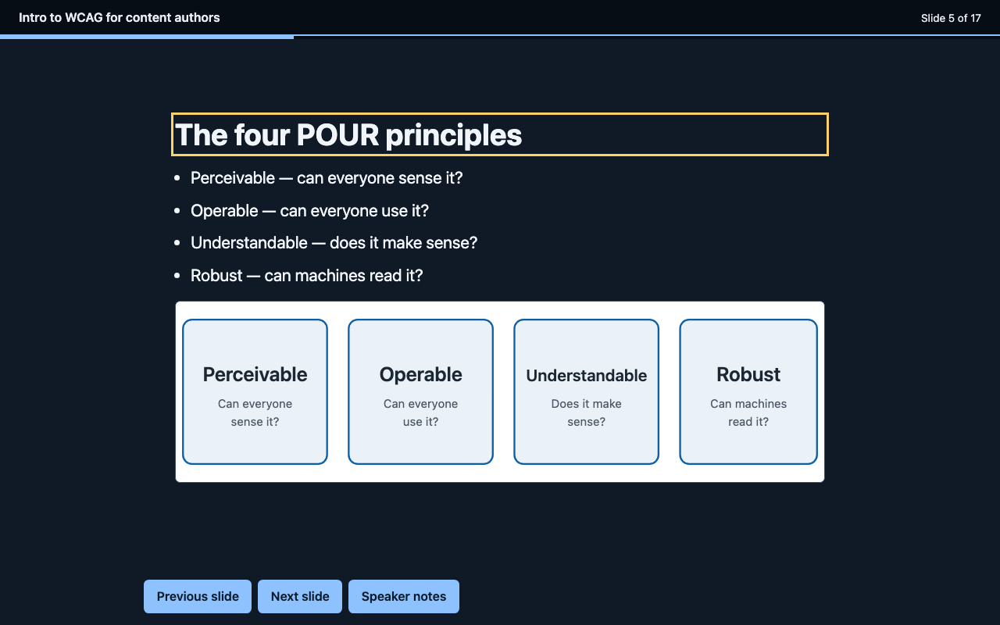

# slidewalk

Lesson outline in, WCAG-gated dual-format deck out. An agent-skill-style toolchain for curriculum developers and instructional designers: one markdown outline becomes an accessible single-file HTML deck **and** a native PPTX — and the build fails if the accessibility gates say no.

**[Live case study + reference deck](https://iwyusdaz.github.io/slidewalk/)** · **[Reference deck (HTML)](docs/deck.html)** · **[Facilitator guide](docs/facilitator-guide.md)** · Role: sole designer



> **Evaluation status:** Automated accessibility gates and negative tests are complete and reproducible. Educator review of the generated content is pending (protocol ready in `evaluation/human-protocol/`). No real learners or assistive-technology users have tested this yet. See `evaluation/METHODS.md`.

## The problem

The best open-source deck generators make beautiful slides and treat accessibility as a claim, not a gate. Real decks shipped to students fail on predictable things: missing alt text, contrast failures, heading-order chaos, keyboard-dead HTML decks, speaker notes nobody wrote. slidewalk makes accessibility a build gate with veto power: if the deck fails, the build fails, with a fix list.

## Audience and context

Curriculum developers and instructional designers who produce teaching decks on deadlines. They write outlines, not code. slidewalk takes the artifact they already have and returns the artifacts they must deliver — a web deck for learners and a PPTX for the LMS.

## The pipeline

```
lesson outline (markdown)
  ├─ 1. VALIDATE      alt text required on informative images · no orphan checkpoints
  │                   · one idea per slide · lang set          → build refused on failure
  ├─ 2. PEDAGOGY      retrieval-practice checkpoint auto-inserted every N content slides,
  │                   template-derived from the slide's own objective, visibly labeled
  ├─ 3. DUAL BUILD    single-file HTML deck (keyboard nav, notes toggle, 320px reflow safe)
  │                   + native PPTX (python-pptx: real text frames, notes per slide)
  ├─ 4. GUIDE         facilitator-guide.md: objectives, notes, checkpoint prompts
  └─ 5. GATES         axe (0 critical/serious) · keyboard traversal of every slide
                      · 320px reflow · contrast ≥ 4.5:1 · alt text · one h1 · lang
                      → failure = non-zero exit + actionable fix list
```

## Quick start

```bash
npm install                      # playwright + axe-core (pinned)
npm run build                    # outline → docs/deck.{json,html,pptx} + guide
npm run gates                    # accessibility gates on the reference deck
sh tests/run-negative-tests.sh   # prove the gates catch seeded failures
npm run pptx:verify              # round-trip the PPTX with python-pptx
npm run gates:themes             # gate the 3-theme pack on its probe deck
```

Write your own outline (`examples/wcag-authors/outline.md` is the reference format), then:

```bash
node skill/scripts/slidewalk.mjs build my-outline.md --out dist --theme ember --pptx --guide
node tooling/run-gates.mjs dist/deck.html
```

Themes: `slate` (light), `midnight` (dark), `ember` (warm paper). Every theme is itself gated on a fixed probe deck before any deck is generated on it (`npm run gates:themes`).

## Key design decisions

1. **Gates audit all slides, not just the visible one.** The gate runner unhides every slide before running axe, then re-tests navigation on the real page. Running axe only on the initial view would pass decks whose slides 2–17 were never audited.
2. **The alt-text rule is enforced twice.** The deck validator refuses to build a deck whose informative images lack alt text (fail early, one-line fix); the gate runner checks the HTML again (fail late, defense in depth).
3. **Checkpoints are template-generated and labeled.** Retrieval prompts derive deterministically from each slide's objective, insert every 4 content slides (configurable), cite their source slide, and carry a visible "Auto-generated retrieval prompt — review before teaching" label. No LLM is in the loop.
4. **One intermediate deck JSON feeds both formats.** An outline edit or a gate fix regenerates HTML, PPTX and guide identically.
5. **Themes are verified assets.** Each theme renders a fixed probe deck through the full gate suite before anything is built on it.

## Evidence and evaluation

Measured 2026-10-31, reproducible from the repo root:

| Check | Result | Command |
|---|---|---|
| axe (WCAG 2.1 A/AA + best practice, all 17 slides visible) | 0 critical / 0 serious / 0 moderate / 0 minor | `npm run gates` |
| Keyboard traversal (all slides, forward + reverse + Home/End/Space, focus, notes toggle) | PASS | `npm run gates` |
| 320px reflow, every slide | PASS | `npm run gates` |
| Contrast ≥ 4.5:1 | PASS | `npm run gates` |
| Alt text + one h1 + heading order + lang | PASS | `npm run gates` |
| Theme probes (slate / midnight / ember) | all PASS | `npm run gates:themes` |
| Negative test: seeded failures caught (build refusal + 6 gate classes) | PASS | `sh tests/run-negative-tests.sh` |
| PPTX round-trip (zip parts + python-pptx re-read of titles, bullets, notes) | 17/17 slides | `npm run pptx:verify` |

**What this evidence can show:** the HTML deck passes the automated WCAG 2.1 A/AA checks axe implements, every slide is keyboard-reachable, the layout reflows at 320px, and the gates demonstrably catch failures. **What it cannot show:** that the deck is usable with a screen reader, that the alt text is *good* (only that it exists), that the teaching works, or that the auto-generated questions are pedagogically sound.

## Accessibility

This repository's outputs are gated, not certified. The reference deck and the case-study site pass the automated checks in the table above; see the [accessibility statement](docs/accessibility-statement.html) for exactly what was and was not tested. Manual and assistive-technology testing is still recommended before high-stakes delivery — the deck's own footer, the facilitator guide, and the gate output all say so.

## Honest limitations

- **Automated ≠ accessible.** Gates cover automated WCAG 2.1 A/AA checks only.
- **PPTX accessibility is not enforced from code.** PowerPoint's own Accessibility Checker is recommended (in the facilitator guide) but cannot be run here. PPTX figures are labeled text placeholders; images render in the HTML deck.
- **Checkpoints are templates**, labeled as such, citing their source slide; educators are told to personalize them.
- **No screen reader testing, no human testing yet.** Protocols are ready in `evaluation/`.
- **AI assistance:** this toolchain and its reference content were built with AI assistance and reviewed by the repository owner for code quality and output correctness. That review is not educator review and not accessibility-user review.

## What I'd do differently / next steps

- Add an automated VoiceOver (Guidepup) gate; support PPTX images (SVG→PNG); side-by-side theme bake-off on the user's real content; LLM-assisted (but clearly labeled and human-reviewed) question drafting behind an opt-in API key.

## Tools used

Node.js, Playwright 1.57, axe-core 4.11.1, python-pptx 1.0.2, gitleaks. AI assistance as disclosed above.

## License and attribution

Code: [MIT](LICENSE). Deck content and case-study text: [CC BY 4.0](https://creativecommons.org/licenses/by/4.0/). Architecture inspiration (patterns adopted, no code copied): [zarazhangrui/frontend-slides](https://github.com/zarazhangrui/frontend-slides) and [hugohe3/ppt-master](https://github.com/hugohe3/ppt-master) — see [ATTRIBUTION.md](ATTRIBUTION.md).
